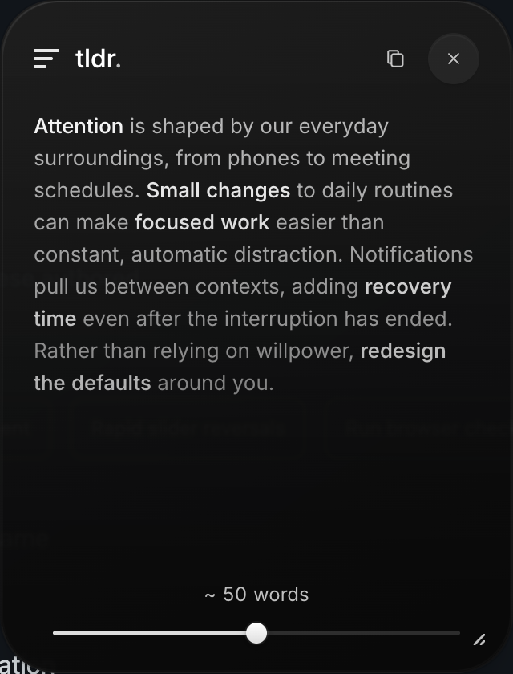

# TLDR

A Chrome extension that summarizes selected text in the approved floating glass dialog. The slider switches locally between five progressively expanded levels, preserving shared text and the original animations.

## Release status

Developer preview: TLDR currently needs an unpacked Chrome extension **and a local Node 24 backend**. It is not a one-click Chrome Web Store release. Each user supplies their own OpenAI API key and pays their own API usage; the project ships no credentials or hosted summary service. The persistent background helper currently supports macOS; other platforms need a manually managed backend.

## Rights and permissions

Copyright © 2026 Sunny Nanavati. TLDR is licensed under **GNU GPL version 3 only (GPL-3.0-only)**; see [LICENSE](LICENSE). You can use it with your own API key, fork it, add features, and redistribute it, including commercially. When distributing modified versions, preserve the required notices and provide corresponding source under GPL-3.0. Private modifications do not need to be published. The software comes without warranty.

Third-party dependencies and assets retain their own licenses. Extension builds include `LICENSE.txt`, `THIRD_PARTY_LICENSES.txt`, and Inter’s `OFL.txt`. Contributions are welcome under the same GPL-3.0-only license; run `npm run verify` and keep credentials and private content out of pull requests.

## Fresh setup

Clone this repository (`git clone https://github.com/sunnynanavati/tldr.git && cd tldr`) or download and extract its source ZIP, then open a terminal in that folder.

1. Install/use Node 24 LTS (`.nvmrc` specifies 24), then run `npm ci` and `npm run build`.
2. Open `chrome://extensions`, enable Developer mode, choose **Load unpacked**, and select `dist/extension`.
3. Create `.env` from `.env.example` (on macOS/Linux: `cp .env.example .env && chmod 600 .env`). Add `OPENAI_API_KEY`, generate a local token with `npm run token`, and set `TLDR_EXTENSION_ID` to the ID Chrome shows. Keep `.env` private and untracked.
4. On macOS, run `npm run service:install` for the persistent backend. For manual development, use `npm run dev:server` (or `npm start` after building).
5. Open the extension’s connection settings. Paste **TLDR_LOCAL_TOKEN**, save, and test. Never paste the OpenAI key into the extension.

After source changes, run `npm run build`, click **Reload** on TLDR’s card in `chrome://extensions`, and reload pages that previously used TLDR. After backend source or project `.env` changes, run `npm run service:restart`; it rebuilds the installed backend and refreshes its private environment copy. `npm run build` alone does not update the installed service.

## Development and verification

| Command | Purpose |
| --- | --- |
| `npm run dev` | Fixture page and component preview at `http://127.0.0.1:4174` |
| `npm run dev:fixtures` | Authenticated backend for the exact authored fixture passages; no OpenAI calls |
| `npm run dev:server` | Real OpenAI backend at `http://127.0.0.1:4317` |
| `npm run verify` | Type checking, lint, unit/integration tests, and production builds |
| `npm run test:ai` | Three live AI calls using authored English and Chinese fixtures; skipped without a key |

The fixture page provides selection shortcuts, loading/error scenarios, rapid replacement, and **Run browser checks**. Its strict-CSP test page exercises style isolation and font loading. Development fixtures are excluded from the extension build. Fixture mode never returns a canned summary for unrelated text.

The original studio remains at `prototypes/tldr.html`. Its saved preset and `prototypes/tldr-ui-spec.md` are the visual reference. The extension imports that frozen preset; it has no appearance inspector.

## Implementation

`src/ui` owns the dialog, scoped styles, packaged font, word reveal, counter, slider, and progressive blur. `src/shared` owns validated types, Unicode word counting, and the cancellable summary session. `src/extension` handles Chrome selection, injection, local-token settings, and requests. `src/server` owns authentication, limits, prompt construction, and the OpenAI call.

The extension uses `activeTab` only after a context-menu invocation. A manual top-layer popover avoids page stacking/clipping, and Shadow DOM isolates the approved CSS. The font is decoded from bundled bytes so the page does not need to permit font requests. The panel defaults to 320 × 420px and clamps to the viewport. Drag the header to move it; drag the lower-right handle to resize. Click either handle for adjustment buttons, or focus it and use arrow keys (Shift for 1px steps). Outside clicks, Escape, and source-page scrolling leave it open; Close dismisses it. New selections replace the tray, and page navigation ends the session. Geometry lasts for the current tray only.

`POST /v1/summaries` accepts `{ requestId, text }` and returns `{ requestId, levels, wordCounts }`. Each level is a complete summary with `runs: [{ text, emphasis }]`. Counts are computed exactly in code; the UI shows “~ x words,” rounded up to the nearest ten. Counter rolls travel through intermediate integers with blur, then settle directly without a finishing pulse or blink. Model output is rendered as text, never HTML.

Passages with at least 40 Unicode words receive five progressively expanded levels; shorter passages receive one. Selections under four words get an instruction to select a complete sentence. Input is limited to 200,000 UTF-16 code units (approximately 30,000–40,000 English words), two active requests, and ten attempts per minute. Passage requests use 20-second backend and 25-second UI deadlines; article jobs use 90 and 95 seconds respectively; selections above 40,000 characters use 180 and 185 seconds for a section-reading pass plus synthesis (see Long article reading below). Sparse highlights in substantial new details trigger at most one corrective generation within that same backend deadline; this can use a second synthesis call. Very long selections additionally use section-reading and quality-review calls described below. A failed attempt offers Retry; dragging the slider makes no API calls.

For longer passages, the provider returns a composition plan with a shared lead sentence, a short insertion inside it, and ordered supporting parts. The backend compiles this into complete levels without rewriting retained words. Short selections use a single compact summary. The model annotates short prose runs with takeaway, qualifier, name, subject, supporting, or plain roles. Shared annotations retain the core as detail grows. The backend reserves the main takeaway and first mentions of names, then prioritizes essential caveats, context, and supporting cues, and converts these into ordinary emphasis flags without separately quoted phrases. Subject-only output is rejected. Usually 1–3 words are emphasized per phrase; up to six are allowed to preserve meaning or negation. The guard permits `max(10, ceil(wordCount / 12))` phrases within `max(6, ceil(wordCount * .35))` highlighted words and excludes whole sentences. See [the highlight policy](docs/highlight-policy.md) and [live quality samples](docs/summary-quality-samples.md). The renderer matches retained words, animates their new positions, and reveals inserted details in reading order using the approved 500ms/29ms/3px reveal, including mid-sentence additions. Shared words move into place over 240ms. Shortening uses the previous fast exit (180ms with a bounded stagger), while gaps close immediately over 240ms; rapid changes cancel superseded motion.

Ordinary selections and section reading use `gpt-6-luna` with reasoning disabled. For selections over 40,000 characters, final composition and quality review use `gpt-6-sol` with low reasoning effort; the small model did not reliably pass long-form quality checks. All calls use strict structured output and `store: false`. `OPENAI_MODEL` configures the base model; `OPENAI_LONG_MODEL` configures long-article synthesis/review. If a custom base model is configured without a long-model override, it is reused for both. This is explicit routing by input length, not an unbounded fallback after errors. The stronger model and extra passes cost more; see [model pricing](https://developers.openai.com/api/docs/models/gpt-6-sol).

## Local security and data handling

The backend binds only to `127.0.0.1`. Every request requires the local bearer token. Requests with an Origin must match the configured extension; Chrome can omit Origin on privileged extension requests, so those also provide the configured extension ID. Foreign web Origins are rejected even if they supply that ID. The ID is routing validation, not a secret or a replacement for the token.

The local token is stored in extension storage restricted to trusted extension contexts. The OpenAI key stays in the user’s local backend: an ignored `.env` file and, on macOS, a private installed copy. These files are plaintext, not Keychain-encrypted. The login service restricts its copy to the current OS user. Chrome stores only the local connection token; this is not an encrypted vault. TLDR sends only selected text, retains summaries in memory during an active request/panel (abandoned backend jobs expire after a 30-second polling lease), and does not log selected passages, generated text, or credentials. The selected text is transmitted to OpenAI over HTTPS. `store: false` does not mean zero retention by OpenAI; its account-level data policies still apply. See [data handling](docs/privacy.md).

## Supported scope

Chrome 120+ on ordinary HTTP/HTTPS pages. Restricted browser pages, the Chrome Web Store, browser PDF viewers, and native applications are outside this release. Selections from frames can use a centered panel when their geometry is unavailable. Controls are English; summaries match the source language. RTL text and scripts absent from Inter use browser/system text rendering and fallback fonts.

## Validation

See `docs/validation.md`, `docs/browser-checks.txt`, and `docs/screenshots/` for the verification record. Live model quality remains a separate check from deterministic UI and contract tests.

After updating from the original append-only build, reload TLDR at `chrome://extensions` and refresh the source page. The backend and extension must both use the new `levels` response contract.

## Design studio

Run `npm run dev`, then open [Glass studio](http://127.0.0.1:4174/prototypes/tldr.html). The studio starts from the same locked preset as the extension, with current hybrid expansion, keyword fixtures, rolling counter, and slider behavior. **Reset to live** restores that baseline; individual resets and **Copy settings** remain available. Experiments autosave locally in `tldr.glass-studio.v4` and never modify the extension. Earlier v3 experiments remain stored separately.

`npm run sync:studio` embeds the shared preset, dialog CSS/markup, animation controllers, and fixtures into the standalone `prototypes/tldr.html`. Production builds run this sync automatically to keep the studio current. The HTML still works offline without runtime dependencies or AI calls. Its settings remain independent from the locked extension preset until explicitly promoted.

### Adaptive summary lengths

Selections under 40 words get one compact summary. Longer selections have five targets. Ordinary passages retain approximately 20/35/55/80/110 words (scaled down when needed). For articles, Detailed grows to 25% of the source, capped at 800 words; Essential/Concise/Balanced/Expanded cap at 60/140/300/550. Targets are approximate, not forced padding; actual counts are measured and displayed rounded up to ten.

| Source words | Essential | Concise | Balanced | Expanded | Detailed |
| --- | --- | --- | --- | --- | --- |
| 200 | 20 | 35 | 55 | 80 | 110 |
| 1,000 | 45 | 80 | 125 | 182 | 250 |
| 3,000 | 60 | 140 | 300 | 545 | 750 |
| 4,000 | 60 | 140 | 300 | 550 | 800 |

The 200,000-character input limit applies; over-limit selections are rejected rather than truncated. Provider output budget grows from 4,000 to 12,400 tokens, including annotations, rather than duplicating full levels. Highlight phrase limits grow with length. Word reveal retains its 500ms blur/rise, with the total stagger window capped at 3.2 seconds for long summaries. Passages retain the 20/25-second backend/extension deadlines. Articles use authenticated in-memory jobs with 90/95-second deadlines (180/185 seconds above 40,000 characters) and one-second status polling, so each Chrome fetch is short. A 30-second polling lease cancels abandoned jobs; results are deleted after delivery or cancellation. Longer responses may cost more and take longer; timeout remains a retryable error. The design studio keeps its authored reference summaries.

To exercise long articles through the running backend with an original synthetic report: `TLDR_SMOKE_HTTP=1 node --env-file-if-exists=.env --import tsx scripts/adaptive-smoke.ts`. This makes a paid provider request and saves counts and sample output in `docs/adaptive-summary-smoke.json`.

## Long article reading

Above 40,000 characters, TLDR first reads the entire selection in contiguous sections of at most 18,000 characters, preferring paragraph/sentence boundaries. Adjacent context overlaps by 800 characters so references and qualifications near a boundary remain visible. Every character belongs to a section; none is silently dropped. Each section produces up to six source excerpts covering findings, named actors, numbers, limitations, and reversals. The model selects existing numbered sentence ranges; the server validates their bounds and retrieves the original wording itself, avoiding paraphrased or invented quotations. A failed or unverifiable section fails the whole job instead of returning a partial summary.

The final composition call receives **the full original article plus the ordered evidence index**. Long-article compositions use inline annotated prose runs throughout, avoiding a separate takeaway-string field that could be mistaken for an appended label. It reconciles later corrections and caveats, then creates the same five progressive levels. The evidence index helps coverage; it does not replace the source with a lossy intermediate summary. A final low-reasoning review compares all assembled levels against the original for factual consistency, important omissions, grammar, and repetition. One correction is allowed within the same deadline and shared two-attempt synthesis budget. A failed final review is an error, never a silently accepted draft. Repetitive sources may produce much shorter summaries than the targets. Shorter selections retain the existing single-pass path.

There are at most three simultaneous section calls per request, at most 23 sections at the input cap, 1,200 output tokens per section, and two synthesis attempts including any highlight or quality repair. Each successful synthesis can incur one quality-review call (at most two, each capped at 3,000 output tokens). Transient connection/5xx failures may retry once per section, at most twice across the whole article; authentication, billing/rate limits, refusals, and invalid evidence fail without automatic retry; the evidence index is reused for a highlight correction. With the existing two-request admission limit, at most six section calls can be in flight. Closing the tray, a deadline, or one failed section cancels remaining work. A long job has a three-minute backend deadline and retains the existing polling lease and in-memory-only data handling. It requires more API work and can cost more than a normal article.

Detailed still targets 25% of the source up to **800 words**. At this input size, that is selective coverage of major points, not an exhaustive digest. Source-verified quotes do not prove that a final summary is factually perfect or that every important point was selected. This design follows the section-based reading approach in the [OpenAI long-document cookbook](https://developers.openai.com/cookbook/examples/summarizing_long_documents), while also retaining the full source during synthesis.

Run `node --env-file-if-exists=.env --import tsx scripts/long-article-smoke.ts` for a paid, credential-gated test using an original roughly 200,000-character report with early, middle, and late facts. It saves `docs/long-article-smoke.json` for manual review. The automated keyword probes are coverage signals, not a general semantic-quality guarantee.

## macOS background backend

`npm run service:install` installs the current backend and Node 24 runtime into `~/Library/Application Support/TLDR/backend`, with a per-user launch agent at `~/Library/LaunchAgents/com.tldr.backend.plist`. The service directory is private (0700); its environment file is 0600. Credentials are read from a private copy of the project's `.env`, never embedded in the launch-agent plist. The service listens only on `127.0.0.1:4317` and keeps the same authentication. No administrator privileges or system-wide daemon are needed.

- `npm run service:status`: checks launchd registration and authenticated backend readiness.
- `npm run service:restart`: rebuilds/reinstalls the current backend and refreshes `.env` from the project. Use after source or credential changes.
- `npm run service:uninstall`: stops the service, removes the login agent and its installed files/credential copy; preserves the project and original `.env`.

The agent uses KeepAlive with a 10-second restart throttle. It runs while this user is logged in; it does not run before login, during sleep, or after logout. Startup errors go to the private service directory's `service-error.log`; regular output is discarded. Selected text, summaries, and credentials are not deliberately logged. If port 4317 belongs to a manually started backend, installation asks you to stop that process instead of killing an unknown listener.

The extension cannot start a local OS process on its own. Previously, a backend launched from a temporary terminal session could disappear when that session ended, causing the recurring “Start the local TLDR backend” error. The login service removes that dependency.

## Release checks

Run `npm run verify`, `npm audit`, and `npm run package:extension` before sharing a build. Packaging regenerates the extension and ZIP together and scans the current source, Git history, and build files for key patterns and exact current `.env` secrets. The scanner reports locations only; it never prints credentials. The ZIP contains the extension only, so recipients still need the backend setup above. Packaging requires the `zip` command (included on macOS).

Review [the publication audit](docs/publication-audit.md) before publishing. Do not distribute `.env`, `.runtime`, the installed backend directory, or a ZIP of the whole checkout. For binary releases, provide the corresponding source for that exact build alongside the download, including build scripts and license notices. A source archive from the release tag is a practical way to do this.
